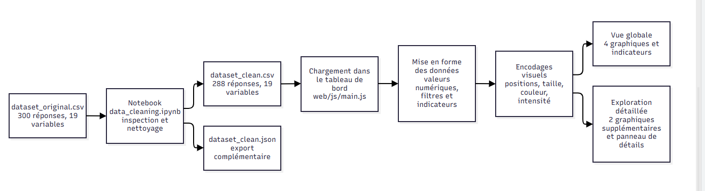

# Projet-Visualisation-Donnees# Projet – Analyse et visualisation de données

## Présentation du projet  

Le projet porte sur la transformation d'un jeu de données de réponses à une enquête sur l’usage d’outils d’intelligence artificielle en un tableau de bord interactif. Les 300 lignes du fichier source décrivent notamment le profil des répondants (type d’utilisateur, pays, niveau d’études), l’outil et l’objectif d’utilisation, le temps d’usage quotidien, le gain de temps hebdomadaire, la précision perçue et la satisfaction. Le nettoyage et la transformation des données a permis de produire une version CSV de la dataset plus propre et utilisée par l’application.

Le tableau de bord permet de comparer les outils et les objectifs, d’examiner la satisfaction et les habitudes d’utilisation, puis de croiser les résultats avec le pays et le niveau d’études. Des filtres coordonnés, des indicateurs synthétiques, des infobulles et des détails accessibles au clic soutiennent l’exploration. Les vues répondent à des questions descriptives sur les répondants observés : elles ne démontrent pas, à elles seules, qu’un outil cause un gain de productivité, et l’échantillon ne doit pas être considéré comme représentatif sans analyse supplémentaire étant données que certaines données n'ont pas pu être justifier au regard des
informations présentes sur le site ou les données ont été récupérées. Il s'agit nottement du revenue pour lequel il n'y a aucune présicion sur le fait qu'il soit convertir en dollars pour tous les pays, ou s'il était enregsitré selon la devise de chaque pays.  

## Utilisateurs visés et besoins

### Utilisateur 1   : Etablissement universitaire (Etudiants et enseignants )
#### Problématique : Comment les étudiants utilisent-ils l'IA dans leurs études et quel impact perçoivent-ils sur leur travail ?
#### Tâches : 
   - Identifier les outils d'IA les plus utilisés par les étudiants.
   - Comparer l'utilisation selon le niveau d'études.
   - Identifier les principales tâches réalisées avec l'IA.
   - Comparer le temps d'utilisation et le temps gagné.
   - Explorer la satisfaction et la productivité perçue des étudiants.

### Utilisateurs 2 : Entreprise et RH (Professionnels et managers)
#### Problématique : Comment les professionnels intègrent-ils l'IA dans leur travail et quels bénéfices perçoivent-ils ?
#### Tâches 
   - Identifier les professions qui utilisent le plus l'IA.
   - Comparer les outils utilisés selon les professions.
   - Identifier les tâches professionnelles réalisées avec l'IA.
   - Comparer le temps gagné et la productivité perçue.
   - Analyser les dépenses mensuelles liées aux outils d'IA.
   - Identifier les professions ayant les niveaux de satisfaction les plus élevés.

### Utilisateurs 3 : Développeurs et entreprises d'outils d'IA
#### Problématique : Quels outils d'IA répondent le mieux aux attentes des utilisateurs ?
#### Tâches 
   - Identifier les outils d'IA les plus populaires.
   - Comparer les outils selon leurs usages et leurs objectifs.
   - Comparer les scores de précision perçue.
   - Identifier les outils ayant les meilleurs scores de satisfaction.
   - Identifier les outils les plus recommandés.
   - Comparer les préférences des étudiants et des professionnels.

## Pipeline de visualisation 

### Pipeline de préparation des données 

#### Step 1 — Collecte des données brutes
Importer le jeu de données initial au format CSV et conserver une copie intacte des données brutes afin de garantir la traçabilité et la reproductibilité.

#### Step 2  — Exploration des données
Analyser la structure du jeu de données, notamment ses 19 variables, les types de données, les valeurs distinctes et les valeurs manquantes, afin d'identifier d'éventuels problèmes de qualité.

#### Step 3 — Traitement des valeurs manquantes
Repérer les valeurs manquantes (`NaN`, `None`), les cellules vides et les entrées composées uniquement d'espaces. Les catégories manquantes sont remplacées par « Non renseigné » ; les champs quantitatifs manquants sont imputés par la médiane de leur colonne.

#### Step 4 — Nettoyage et normalisation des données
Corriger les erreurs de saisie, supprimer les espaces superflus et harmoniser les valeurs, formats et unités de mesure dans l'ensemble des colonnes.

#### Step 5 — Conversion des types de données
Convertir les variables numériques et catégorielles dans les types de données appropriés afin d'assurer leur compatibilité avec les analyses statistiques et la visualisation de données.

#### Step 6 — Traduction et renommage des colonnes
Traduire les valeurs catégorielles en français et renommer les colonnes du jeu de données en suivant une convention de nommage cohérente et explicite.

#### Step 7 — Validation des données
Détecter les enregistrements en doublon, identifier les valeurs aberrantes potentielles, vérifier que les valeurs se situent dans des plages acceptables, et contrôler la cohérence globale ainsi que la fiabilité du jeu de données nettoyé.

#### Step 8 — Exportation du jeu de données nettoyé
Exporter le jeu de données final nettoyé aux formats CSV et JSON, afin de permettre la création des visualisations interactives via D3.js.

>**Résultat final** : un jeu de données propre, cohérent et prêt pour la visualisation.

Le nettoyage peut être exécuté depuis la racine du dépôt avec le script Python :

```bash
python scripts/data_cleaning.py
```

Le script lit `data/dataset_original.csv` et génère `data/dataset_clean.csv` et `data/dataset_clean.json`. Les chemins peuvent être personnalisés avec `--input` et `--output-dir`. Les symboles `$` et séparateurs de milliers des champs numériques sont retirés, sans conversion de devise. Les étapes sont également détaillées dans [`notebooks/data_cleaning.ipynb`](notebooks/data_cleaning.ipynb).

### Encodages visuels et techniques

L’application lit le CSV nettoyé avec D3.js. Elle met en correspondance les colonnes avec les champs utilisés par les graphiques, calcule les effectifs et les moyennes nécessaires, puis redessine les vues selon les filtres. Les menus filtrent le type d’utilisateur, le niveau d’études, le pays, l’outil et l’objectif ; une option permet d’exclure les usages supérieurs à 12 heures par jour. Les clics sur certains éléments appliquent également un filtre ou ouvrent un panneau de détails. Les quatre indicateurs affichent le nombre de répondants sélectionnés, l’usage quotidien moyen, le gain de temps moyen et la satisfaction moyenne.

Les variables quantitatives sont principalement encodées par la **position** sur un axe, plus facile à comparer précisément ; les catégories sont distinguées par la **couleur** ou placées sur des axes catégoriels. Les couleurs des outils et des objectifs sont attribuées par une palette catégorielle D3 (*Tableau 10*) : une couleur identifie une catégorie, elle ne représente pas une valeur « meilleure ». Les valeurs manquantes sont grisées. La carte thermique emploie une échelle séquentielle de bleus : plus le bleu est foncé, plus la valeur affichée est élevée. Les sélections actives sont mises en évidence et les éléments hors sélection sont atténués.

| Vue | Mapping des données vers les variables visuelles | À quoi sert la technique |
|---|---|---|
| **Bulles — évaluation des outils** | Chaque bulle représente un outil. **x** = précision perçue moyenne (sur 5) ; **y** = satisfaction moyenne (sur 10) ; **aire** de la bulle = nombre d’utilisateurs ; **couleur** = outil. | Comparer simultanément popularité, précision perçue et satisfaction. Le nuage de points positionne les catégories selon deux mesures quantitatives ; la taille ajoute une troisième mesure. |
| **Nuage de points — usage et gain de temps** | Chaque point représente un répondant. **x** = heures d’usage par jour ; **y** = heures gagnées par semaine ; **couleur** = objectif d’usage. Une droite de tendance et le coefficient *r* résument la corrélation des répondants sélectionnés. | Explorer une association entre deux mesures, repérer dispersion, groupes et valeurs atypiques. Une corrélation n’implique pas une causalité. |
| **Carte thermique — pays et études** | **Colonnes** = niveau d’études ; **lignes** = pays ; **intensité du bleu** = effectif ou usage moyen (heures/jour), au choix ; **texte dans la cellule** = valeur ; gris = absence de valeur. | Repérer rapidement les cellules avec les effectifs ou les moyennes les plus élevés et comparer les profils pays–études. |
| **Histogramme — satisfaction** | **x** = note de satisfaction arrondie ; **hauteur** = nombre de répondants ; couleur = outil sélectionné, ou bleu par défaut. | Montrer la distribution des notes, leur concentration et leur étalement, plutôt que seulement une moyenne. |
| **Barres horizontales — satisfaction par objectif** *(détail)* | **y** = objectif, trié par satisfaction moyenne décroissante ; **longueur** = satisfaction moyenne sur 10 ; étiquette = effectif et moyenne ; **couleur** = objectif. | Comparer et classer des moyennes entre catégories, tout en rappelant le nombre d’observations associé. |
| **Barres horizontales — outils utilisés** *(détail)* | **y** = outil ; **longueur** = nombre de répondants ; **couleur** = outil ; étiquette = effectif. La vue affiche au plus les huit outils les plus présents dans la sélection. | Comparer les fréquences d’usage et sélectionner un outil pour filtrer les autres vues. |

Les bulles, le nuage de points, la carte thermique et l’histogramme composent la **vue globale**. Les deux graphiques en barres apparaissent dans **Exploration détaillée**, avec un panneau qui présente les informations du répondant, de l’outil ou de l’objectif sélectionné. Les visualisations sont celles présentes dans l’application ; le dépôt n’indique pas quel membre de l’équipe est responsable de chacune.


### Présentation du pipeline sous forme de workflow 


## Architechture du projet 
[data/dataset_original.csv](../data/dataset_original.csv) : données source.
[data/dataset_clean.csv](../data/dataset_clean.csv) et [data/dataset_clean.json](../data/dataset_clean.json) : sorties du nettoyage.
[notebooks/data_cleaning.ipynb](../notebooks/data_cleaning.ipynb) : fichier  d'inspection,  de préparation et d'export des données.
[scripts/data_cleaning.py](scripts/data_cleaning.py) : script exécutable de nettoyage et d'export des données.
[web/index.html](../web/index.html), [web/js/main.js](../web/js/main.js) et [web/css/style.css](../web/css/style.css) : interface, visualisations et présentation du tableau de bord.
[/requirements.txt]: fichier fournissant les dépendances Python.


## Technologies utilisées
- Python 3.12
- Jupyter Notebook
- NumPy
- Pandas
- Matplotlib
- Seaborn

## Installation

### 1. Cloner le dépôt GitHub

```bash
git clone URL_DU_DEPOT
```

### 2. Créer un environnement virtuel

```bash
python -m venv .venv
```

### 3. Activer l'environnement virtuel

Sous Windows :

```bash
.venv\Scripts\activate
```

Sous macOS/Linux :

```bash
source .venv/bin/activate
```

### 4. Installer les dépendances

```bash
python -m pip install --upgrade pip
python -m pip install -r requirements.txt
```

### 5. Lancer Jupyter Notebook

```bash
python -m jupyter notebook
```

### 6. Utiliser le projet

Ouvrir le notebook situé dans le dossier `notebooks/`.

**Important :** sélectionner le kernel Python correspondant à l'environnement `.venv`.

